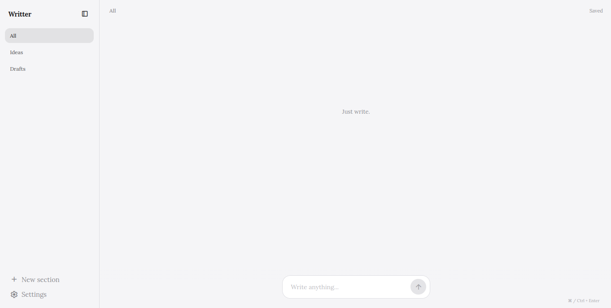
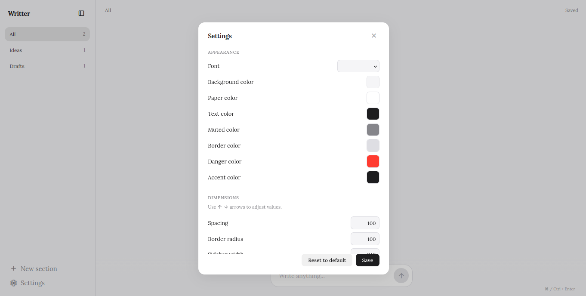
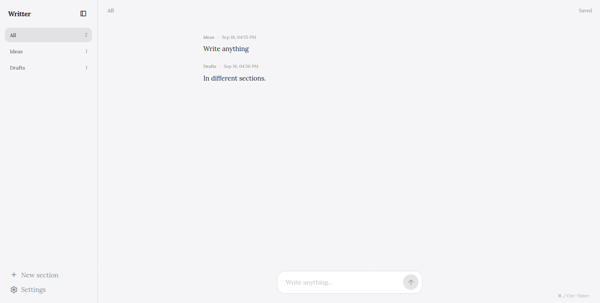

# Writter

A minimal, distraction-free writing app built with vanilla HTML, CSS, and JavaScript. No frameworks, no build tools, no dependencies.

---



---

## Features

- **Section-based organization** -- group your writings into named sections
- **Real-time auto-save** -- every change is persisted to localStorage instantly
- **Fully customizable appearance** -- fonts, colors, spacing, dimensions
- **Collapsible sidebar** -- toggle between expanded and icon-only mode
- **Keyboard shortcuts** -- `Cmd/Ctrl + Enter` to save, `Escape` to close modals
- **Responsive design** -- off-canvas section drawer on phones, keyboard-aware composer, notch/safe-area handling
- **Installable PWA** -- runs standalone from the home screen on iOS and Android
- **Works offline** -- the app shell and the icon font are served from cache once visited
- **Smooth animations** -- text-swap save indicator, exit transitions, modal open/close

---

## Customization

All visual aspects of the app can be configured through the Settings panel.



### Appearance

| Setting | Description |
|---------|-------------|
| Font | Choose from 6 font families (Lora, Poppins, Comic Relief, Huninn, System UI, Georgia) |
| Background color | Main app background |
| Paper color | Writing area background |
| Text color | Primary text color |
| Muted color | Subdued text and labels |
| Border color | Input borders and dividers |
| Danger color | Error states and destructive actions |
| Accent color | Interactive elements highlight |

### Dimensions

| Setting | Range | Default |
|---------|-------|---------|
| Spacing | 50--150% | 100% |
| Border radius | 0--200% | 100% |
| Sidebar width | 160--320px | 240px |
| Input height | 28--56px | 40px |

---

## Usage



1. Open https://writter-one.vercel.app in any modern browser
2. Click **New section** in the sidebar to create a named group
3. Type in the composer at the bottom and press `Cmd/Ctrl + Enter` to save
4. Click the **Settings** icon to customize colors, fonts, and dimensions
5. Click the **dock icon** in the sidebar header to collapse it

---

## Project Structure

```
writter/
├── index.html
├── manifest.json          # Web app manifest (name, icons, display mode)
├── sw.js                  # Service worker: offline shell + Google Fonts cache
├── assets/
│   ├── icons/             # PWA icons (generated, not hand-edited)
│   └── images/
├── tools/
│   └── gen-icons.py       # Regenerates assets/icons with Pillow
├── css/
│   ├── variables.css        # Design tokens (colors, spacing, typography)
│   ├── reset.css            # CSS reset / normalize
│   ├── sidebar.css          # Sidebar layout and collapsed state
│   ├── main.css             # Main content area
│   ├── composer.css         # Input composer at the bottom
│   ├── modal.css            # Section create/rename/delete modal
│   ├── settings.css         # Settings panel
│   ├── responsive.css       # Breakpoint adjustments
│   ├── text-swap.css        # Save indicator animation
│   └── exit-animations.css  # Element removal transitions
└── js/
    ├── app.js               # Entry point, initializes all modules + registers the SW
    ├── store.js             # Data model and localStorage persistence
    ├── dom.js               # Cached DOM element references
    ├── feed.js              # Feed rendering, entry CRUD, keyboard/viewport handling
    ├── modal.js             # Section modal (create/rename/delete)
    ├── sidebar.js           # Section list, drawer and sidebar toggle
    └── settings.js          # Settings config, rendering, and application
```

---

## Architecture

The app uses a **data-driven settings system**. All settings are defined as a configuration array in `settings.js`:

```js
const settingsConfig = [
  {
    section: "Appearance",
    fields: [
      { id: "setBg", label: "Background color", type: "color", settingsKey: "bg" },
      // ...
    ],
  },
];
```

Adding a new setting requires only adding a single object to the config -- no HTML or additional JS needed.

---

## Data

All data is stored in `localStorage` under the key `meu-espaco-escrita-v1`. Clearing browser data will reset the app.

---

## PWA

The app is installable and keeps working without a connection.

- **Install** -- use *Add to Home Screen* (iOS Safari) or *Install app* (Chrome/Edge). It opens without browser chrome, with the status bar matching the app background.
- **Offline** -- the first visit registers `sw.js` and precaches the shell (HTML, CSS, JS, icons). From the next visit on, the page and the Google Fonts -- including the Material Symbols icon font -- are served from cache, so the icons never degrade to literal text.
- **Updates** -- there is no automatic `skipWaiting()`, so an update applies on the next launch and can never pair a new CSS file with an already-open page. When you change cached files, bump `VERSION` at the top of `sw.js` so the old cache is dropped.

### Regenerating the icons

```bash
python3 tools/gen-icons.py
```

Writes `assets/icons/` (192, 512, maskable 512, apple-touch 180, favicon 48) with Pillow -- no build tooling involved. Edit `BG`, `INK` and `FONT` in that script to restyle them; keep `--bg` and the manifest `theme_color` in sync.

---

## Tech Stack

| Layer | Technology |
|-------|------------|
| Markup | HTML5 |
| Styling | Vanilla CSS (custom properties) |
| Logic | Vanilla JavaScript (ES modules) |
| Offline | Service worker + Web App Manifest |
| Icons | Google Material Symbols, PWA icons generated with Pillow |
| Fonts | Google Fonts (Lora, Poppins, Comic Relief, Huninn) |
| Storage | localStorage |

---

## License

MIT
